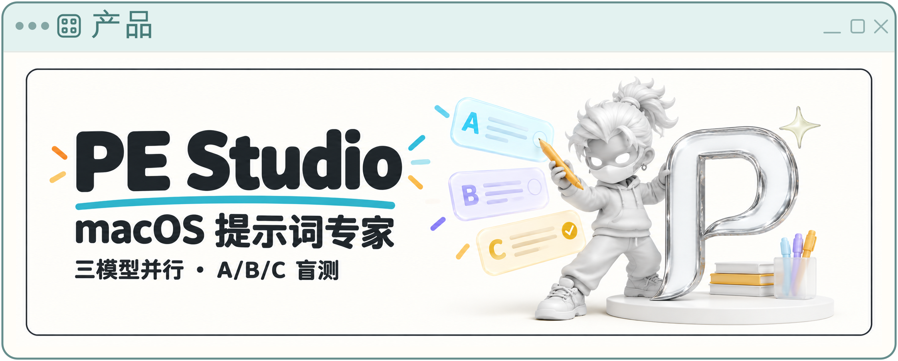
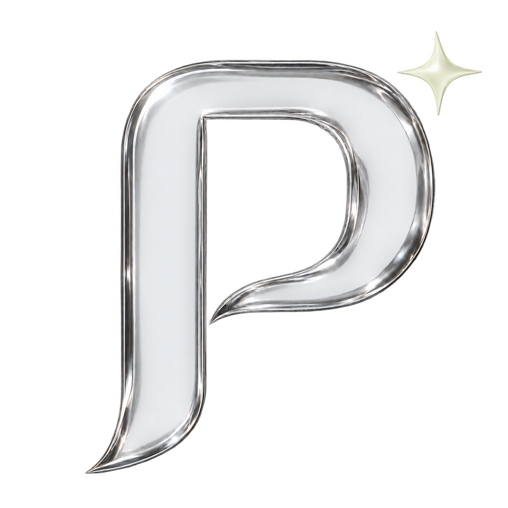

<div align="center">
  
  <h1>PE Studio · 提示词专家</h1>
  <p>让随手写下的想法，变成三份值得比较的提示词。</p>
  <p>macOS 快捷小窗 · 三模型并行 · A/B/C 随机盲测 · Jev 评审</p>
</div>

PE Studio 是一个开源 macOS 桌面工具。按 **Control + Q** 呼出小窗，输入想法，由三个模型各写一份提示词；Jev 对提示词本身评分，你可以比较、揭晓模型身份，再复制喜欢的一份。

当前版本：**0.4.8** · [MIT License](LICENSE) · [反馈问题](https://github.com/17lijunyi/pe-studio/issues)

## 能做什么

- **四个方向**：普通、生图、视频、产品。输出的是提示词文本，不会自动执行提示词或生成图片、视频。
- **三份结果都保留**：并行生成、单独重试、复制、历史与收藏、Markdown 导出。
- **随机盲测**：每轮随机分配 A/B/C，点击“显示模型”一次揭晓全部；本轮切换、重试、历史查看保持相同对应关系。
- **评审与评分**：Jev 匿名评审，评分按真实候选关联；评审失败时保留已生成结果。评分不是目标模型实际运行效果的保证。
- **自由配置**：三个连接位分别选择服务商和模型，目标模型名称也可自由填写。
- **轻量小窗**：点击 A/B/C 展开结果，再点收起；拖动输入窗收起结果；外部点击、Esc 或切换应用收起小窗。
- **Liquid Glass 界面**：小窗、结果泡泡与工作台使用同一套玻璃组件，支持深浅色、减少透明度和减少动态效果；没有永久置顶或固定模式。

macOS 26 及以上通过公开的 `NSGlassEffectView` Clear 材质呈现真实窗口背景与圆角边缘折射。桌面渲染层保持透明，输入、正文和设置字段使用局部阅读衬底；不截屏、不要求屏幕录制权限。旧版 macOS 使用系统 vibrancy 回退。网页端继续使用随项目附带的 [Liquid Glass 0.1.0](vendor/liquid-glass/README.md) Clear 材质与 `variable13`，折射基于应用绘制的中性色 Canvas；WebGL 不可用时显示 CSS 兼容材质。减少透明度或增强对比度时统一改用实色，减少动态效果时停用玻璃按压动效。

桌面外框不叠加整体白底或人工高光环，使用原生 Clear 玻璃及 40pt 曲面圆角，内容向内留白以露出真实背景折射。文字保持原尺寸，不使用位移或形变滤镜。阅读区域只保留一层衬底，避免设置面板、输入框反复叠加造成白色遮盖；桌面回归同时检查 CSS 背景透过率和文字对比度。

## 模型连接

| 接入方式 | 当前配置入口 | 说明 |
| --- | --- | --- |
| 推理时代 / AiHubMix | API Key、接口地址、模型目录或手填 Model ID | 使用服务商支持的模型及实际返回的准确 ID。 |
| DeepSeek | API Key、接口地址、模型目录或手填 Model ID | 与 AiHubMix 分开配置凭据。 |
| 本地命令行 Agent | 检测并选择 Codex CLI、Claude Code、pi、Hermes | 复用用户已有安装和认证；检测成功不等于模型生成必然可用。 |
| Jev | 独立评审连接 | 使用 Typesafe API，需自行配置可用 Key。 |

本地 Agent 以受限文本生成模式工作，不自动安装、登录或启动聊天服务，不调用其完整工具循环。Hermes 当前针对 **0.11.x** 的固定 Python 启动器安装提供纯文本桥；不支持的版本或后端会明确提示。pi 需要可用的本机 Node.js 运行环境。

“负责写提示词的模型”和“这份提示词准备交给的目标模型”是两项不同设置。推荐项只是快捷入口，仍以服务商的可用模型、账号权限和接口要求为准。

## 从源码运行

### 构建条件

- Mac；应用运行目标为 **macOS 13 或以上**。
- **Node.js ≥ 22.13.0** 与 npm。
- **包含 macOS 26 或更新 SDK 的 Xcode / Command Line Tools**：源码要编译原生 Liquid Glass 桥。运行时会检查系统能力，旧系统使用兼容材质；运行最低版本与编译 SDK 要求不同。
- 本机 Node.js N-API 头文件：自动查找当前 Node 安装、Homebrew 常见目录；也可用 `NODE_INCLUDE_DIR` 显式指定含 `node_api.h` 的目录。构建脚本不会自动下载头文件或 SDK。

```sh
git clone https://github.com/17lijunyi/pe-studio.git
cd pe-studio
npm run install:ci
npm run desktop:build
npm run desktop:start
```

如果使用版本管理器安装 Node，而自动查找没有找到头文件，可在执行构建前设置：

```sh
export NODE_INCLUDE_DIR="/path/to/node/include/node"
npm run desktop:build
```

### 构建本机 App

```sh
npm run desktop:local
```

按本机架构生成 App，默认不生成分享 ZIP：

```text
.sites-runtime/local-builds/PE Studio-darwin-arm64/PE Studio.app
.sites-runtime/local-builds/PE Studio-darwin-x64/PE Studio.app
```

实际只生成当前 Mac 对应的一项。日常验证以 Apple Silicon 为主；Intel 构建路径仍需相应真机验证。

将生成的 **PE Studio.app** 放入系统“应用程序”文件夹后启动。更新时先从菜单栏正常退出旧实例，再替换 App，避免单实例锁唤醒旧路径。

当前本地打包使用 **ad-hoc 签名，尚未 Apple 公证**；源码仓库不包含个人 Developer ID 证书。可用以下命令检查本机构建的签名、包内文件和隔离规则：

```sh
node scripts/verify-share-package.mjs \
  ".sites-runtime/local-builds/PE Studio-darwin-arm64/PE Studio.app"
```

### 浏览器开发预览

桌面版无需单独启动 Web 服务。浏览器入口保留供页面开发使用：

```sh
npm run dev
```

默认访问 `http://localhost:5173`。本地克隆不需要 `.openai/hosting.json`；缺少部署配置时使用空的本地云资源绑定。云端连接器、托管登录或 D1/R2 等功能需要各自平台配置，不能把本地预览身份当作生产认证。

浏览器服务端凭据可参考 [.env.example](.env.example)；桌面应用主要通过设置界面配置。请勿将真实 Key 放入 `NEXT_PUBLIC_` 环境变量。

## 使用流程

1. 按 **Control + Q** 呼出小窗，选择方向并输入想法。
2. 点“设置”或按 **Command + ,**，为三个连接位分别配置 API 或本地 Agent；保存按钮在模型框附近。
3. 回到小窗，点击“优化提示词”或按 **Command + Enter**。
4. 点击 A/B/C 阅读结果、比较分数；需要时揭晓模型并复制。
5. 历史、收藏、更多约束和评审详情在后台工作台查看。

| 快捷键 | 行为 |
| --- | --- |
| Control + Q | 呼出小窗；小窗已聚焦时再次按下收起。 |
| Command + Enter | 开始优化。 |
| Command + , | 打开设置。 |
| Esc | 当前菜单或输入法先处理，然后收起小窗。 |

快捷键被其他应用占用时，可从菜单栏入口打开，并在设置中更换。收起窗口不会停止正在进行的生成；完成后也不会主动抢占焦点。

## 数据与密钥

- 桌面 Key 通过 Electron `safeStorage` 使用 macOS 钥匙串保护，密文保存在本机应用数据目录；读取失败时不会降级成明文持久保存。
- 历史、收藏和模型设置保存在本机；API Key 不写入历史或提示词导出。
- 生成和评审会把相应输入、候选提示词发送到你配置的服务商；本地 Agent 也会使用其已有模型连接。
- 模型权限、额度与费用由各服务商或已有 Agent 账户决定，项目不附带账号、Key 或免费调用额度。

## 开发与验证

```sh
npm test
npm run typecheck
npm run desktop:build
```

macOS 桌面交互回归使用隔离数据目录和内存模拟请求，不使用个人 Key：

```sh
PE_STUDIO_SMOKE_DIR="$PWD/.sites-runtime/desktop-smoke" \
PE_STUDIO_SMOKE_PROVIDER=aihubmix \
PE_STUDIO_SMOKE_SET_SHORTCUT=Control+Alt+Shift+F11 \
npm run desktop:start
```

测试结果与截图位于指定目录，包含三个窗口的真实渲染诊断和无障碍降级检查。

```text
app/                  页面与 API 路由
components/studio/    小窗、结果、工作台与模型设置
lib/                  提示词规则、模型协议、盲测与评审
desktop/              Electron 主进程、桥接与原生 macOS 材质
scripts/              构建、安装与包验证
tests/                协议、设置、盲测和本地 Agent 测试
```

更多贡献说明见 [CONTRIBUTING.md](CONTRIBUTING.md)。构建产物、个人运行数据、部署元数据和真实 `.env` 不应提交。

## 许可证与署名

项目原创源码采用 [MIT License](LICENSE)。第三方代码、依赖和品牌标识保留各自权利，见 [THIRD_PARTY_NOTICES.md](THIRD_PARTY_NOTICES.md) 与 [品牌资产来源](docs/brand-assets.md)。

作者：[17lijunyi](https://github.com/17lijunyi)
